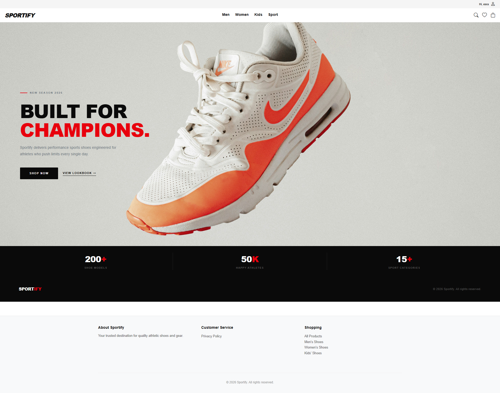
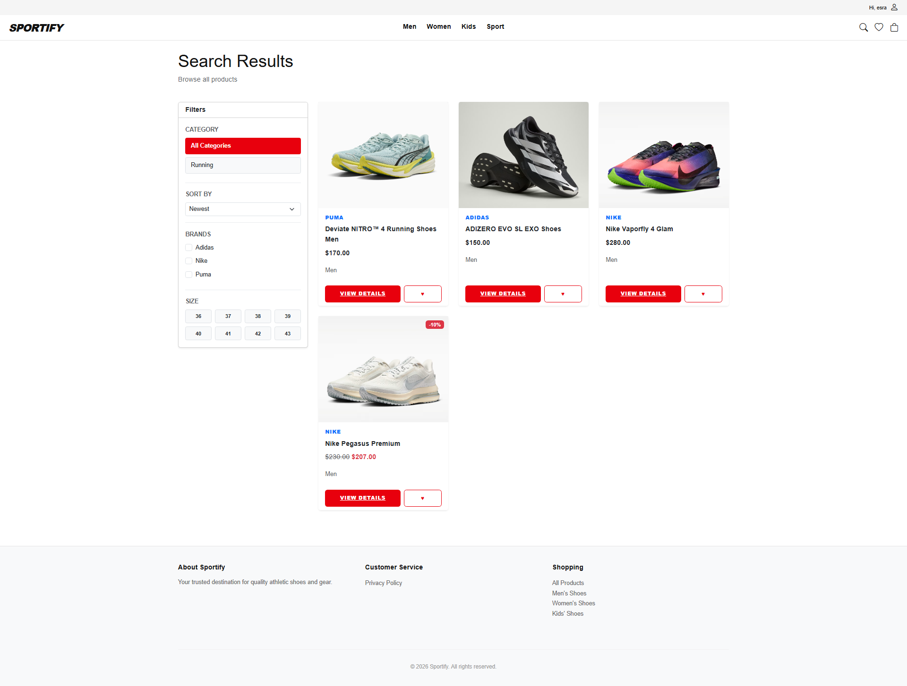
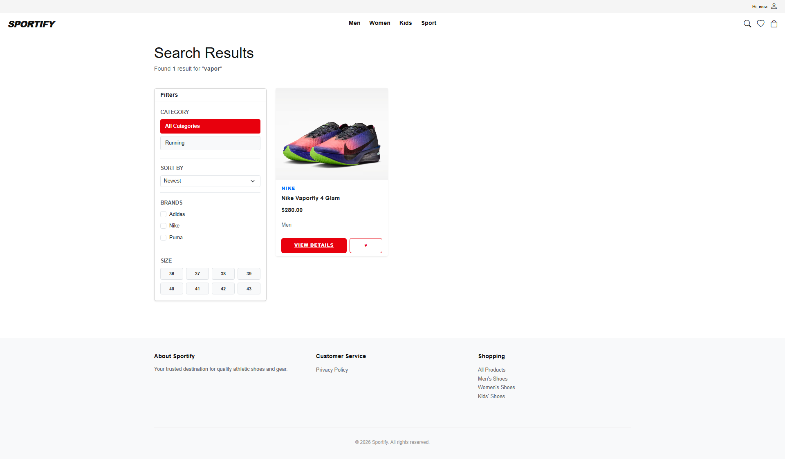
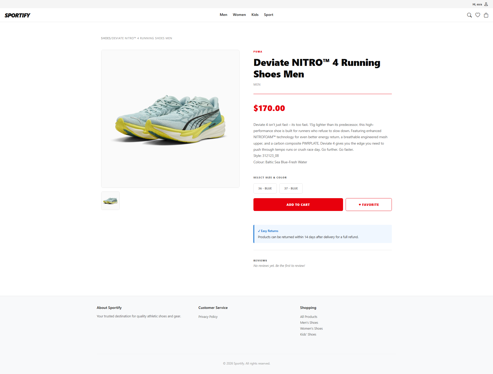
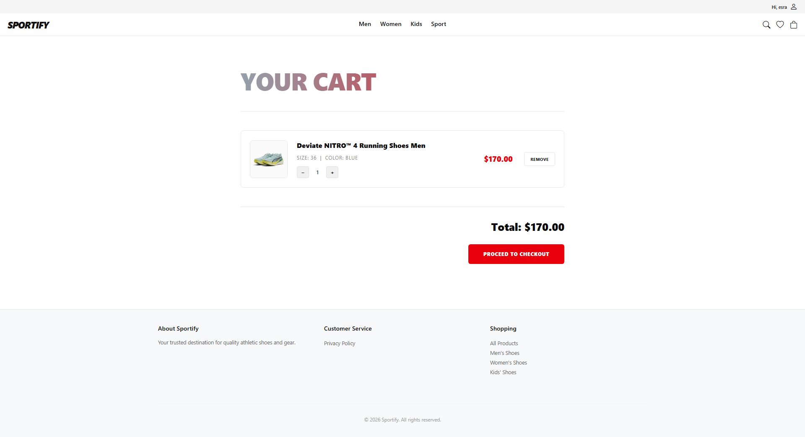
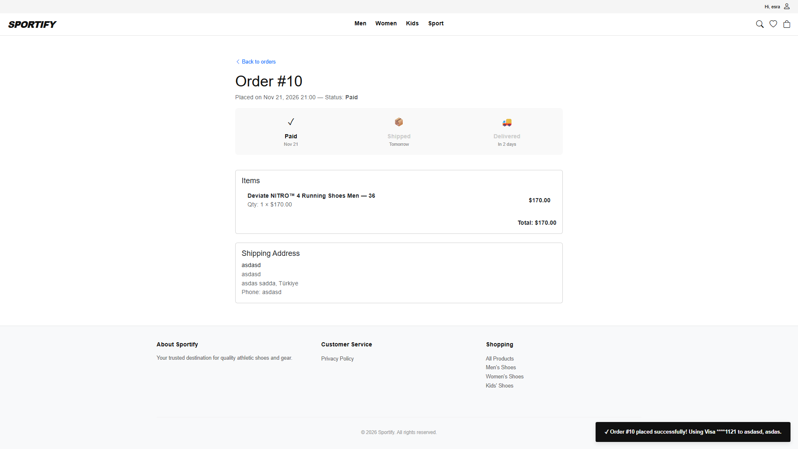
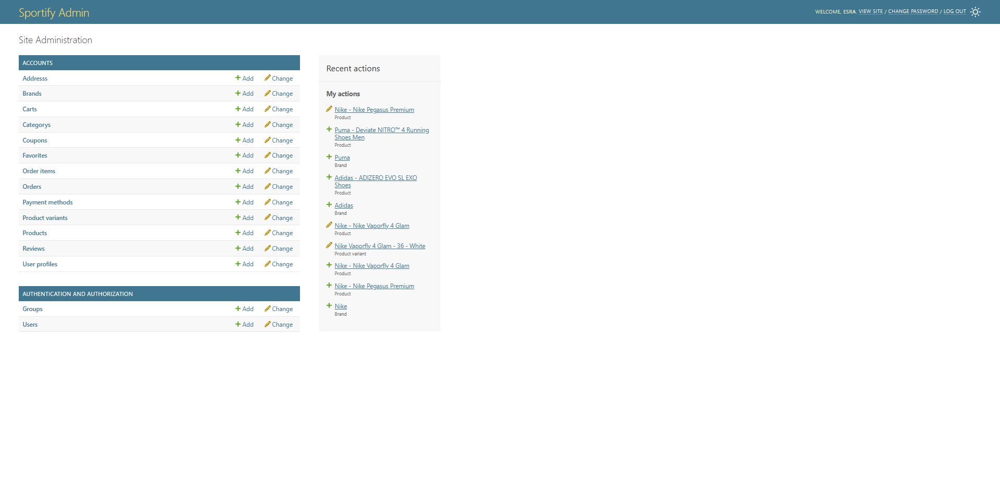

# Sportify

Sportify is a Django storefront for athletic footwear. Shoppers can browse by category, search for shoes, choose a size, save favorites, and place a mock order. Sellers manage their listings through a company dashboard. Administrators manage the catalog and orders through Django admin.



## Run locally on Windows

Install Python 3.12 or later and make sure `python --version` works in PowerShell. From the repository root, run:

```powershell
.\run.bat
```

The launcher creates a virtual environment in `venv`, installs the dependencies from `ecommerce/requirements.txt`, applies database migrations, and starts the Django development server. Open the [storefront](http://127.0.0.1:8000/) in your browser. Press `Ctrl+C` in the terminal to stop the server.

### Manual setup

To run the same steps individually, open PowerShell in the repository root:

```powershell
python -m venv venv
.\venv\Scripts\python.exe -m pip install -r ecommerce\requirements.txt
.\venv\Scripts\python.exe ecommerce\manage.py migrate
.\venv\Scripts\python.exe ecommerce\manage.py runserver
```

### Database migrations

Django stores local data in `ecommerce/db.sqlite3`. On first setup, `migrate` creates the database tables. After pulling changes or restoring an older database, stop the server, back up the database file, and run:

```powershell
.\venv\Scripts\python.exe ecommerce\manage.py showmigrations accounts
.\venv\Scripts\python.exe ecommerce\manage.py migrate
```

`showmigrations` marks applied migrations with `[X]`. For example, if an older database reports a missing `accounts_product.company_id` column and migration `0009` is pending, `migrate` applies the change that adds the seller field. Restart the server after the command completes.

### Create an admin account

After the migrations finish, open a second PowerShell window in the repository root and run:

```powershell
.\venv\Scripts\python.exe ecommerce\manage.py createsuperuser
```

Follow the prompts for a username, email address, and password. With the server running, sign in to [Django admin](http://127.0.0.1:8000/admin/) using the username and password you just created. If you started with an empty database, you can add categories, brands, products, and size variants here to populate the storefront.

## Screenshots

| Browse by category | Search results |
| --- | --- |
|  |  |

| Product details | Shopping cart |
| --- | --- |
|  |  |

### Mock order



### Django admin


